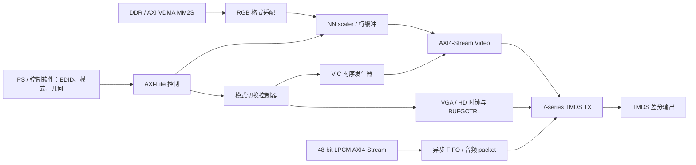

# EmbeddedVideoIP

EmbeddedVideoIP `0.3.0-dev.2` 是面向 Vivado PL + PS 集成系统的 HDMI 视频输出 IP。PL 负责视频格式转换、缩放、输出时序、HDMI packet、TMDS 编码和 7-series 串行输出。外部系统负责 EDID、VDMA、输出模式请求和系统级音频源。

## 架构图



外部系统连接 PS/CIPS、DDR、AXI VDMA、HPD、DDC 和板级引脚。库本身不包含应用 UI、游戏、ROM、应用级帧缓存布局或应用输入映射。

## 当前版本

| 项目 | 当前值 |
| --- | --- |
| 版本 | `0.3.0-dev.2` |
| 目标范围 | AMD/Xilinx 7-series，可选 Zynq-7000 PS 适配器 |
| 最大输入 | `1280×720` |
| 最大输出 | `1920×1080` |
| 视频 profile | CEA-861-D VIC 1、4、34 |
| 输出颜色 | RGB 4:4:4、8 bpc；可选 YCbCr 4:4:4 |
| 音频接口 | 双声道 24-bit LPCM，48-bit AXI4-Stream |
| 音频采样率 | `48 kHz`，可选 `96 kHz`、`192 kHz` |

## HDMI 1.4b 功能范围

| 功能 | 当前状态 | 说明 |
| --- | --- | --- |
| VIC 1、4、34 时序 | 已实现 | 包含时序、VIC、时钟 profile 和模式切换测试 |
| RGB 4:4:4、8 bpc | 已实现 | AVI InfoFrame 与 TMDS 编码已覆盖 |
| YCbCr 4:4:4、8 bpc | 部分实现 | 静态色彩 profile 和 AVI 字段已覆盖 |
| AVI InfoFrame | 已实现 | VIC、色彩格式、色彩矩阵和量化范围随 profile 更新 |
| Data Island、BCH、保护带 | 已实现 | packet assembler、BCH 和 line-slot scheduler 已覆盖 |
| 24-bit LPCM | 已实现 | 48-bit AXI4-Stream，源端负责样本格式和背压 |
| ACR | 已实现 | CTS 按实际像素时钟和 `H_TOTAL` 计算 |
| EDID / E-DDC | 接口已实现 | EDID 解析和 sink 选择由外部系统提供 |
| DVI-safe fallback | 已实现 | 模式切换期间等待时钟锁定和新 VSYNC |
| Deep Color | 待实现 | 需要 30/36/48-bit pixel-group packing |
| 3D、4K、HBR、HDCP、CEC、ARC/eARC | 待实现 | 当前版本不包含这些协议或时序 |

完整条款与 RTL 映射见 [`docs/hdmi-1.4b-conformance.md`](docs/hdmi-1.4b-conformance.md)。

## 构建和验证

```sh
python3 tools/video_flow.py doctor
python3 tools/video_flow.py sim
python3 tools/video_flow.py package
python3 tools/video_flow.py validate
python3 tools/video_flow.py build --part xc7z020clg400-1 --profile composite_audio_on
```

`sim` 运行 RTL、Host C 和 Python 测试。`package` 生成 IP-XACT 包。`validate` 检查 IP Catalog 接口。`synth` 和 `build` 只产生库级/OOC 结果，完整器件 post-route 时序由外部系统单独签核。

## 仓库结构

- `ip/video_pipeline_1_0/hdl/`：canonical SystemVerilog / Verilog。
- `tools/package_ip.tcl`：生成内部视频处理核。
- `tools/package_composite_ip.tcl`：生成组合式 IP。
- `tools/run_video_tests.sh`：执行完整 RTL、Host C 和 Python 测试。
- `ip_repo/`：Vivado IP Catalog 产物。
- `software/`：平台适配 API 和可选的 Zynq-7000 adapter。
- `platforms/`：可复用器件/板卡 profile。
- `tests/rtl/`：SystemVerilog 仿真。
