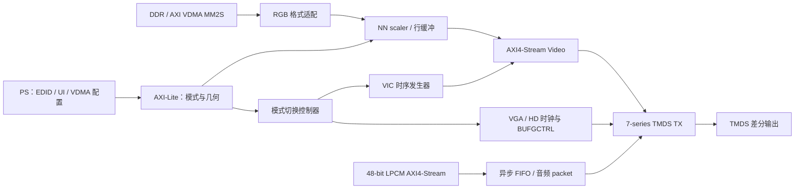

# EmbeddedVideoIP

EmbeddedVideoIP `0.3.0-dev.2` 是面向 Vivado PL + PS 工程的 HDMI 视频输出子系统。消费端在 IP Integrator 中实例化组合式顶层。PL 负责视频格式转换、缩放、输出时序、HDMI packet、TMDS 编码和 7-series 串行输出。PS 负责 EDID、VDMA、输出模式和 HDMI 音频配置。

当前版本是 **HDMI 1.4b 子集实现**。下表区分项目已实现的功能、部分实现的功能和当前未纳入的功能。它不把 RTL 仿真结果写成 HDMI 认证或所有接收设备的电气兼容性证明。

## 架构图



PS/CIPS、DDR、AXI VDMA、HPD 和 DDC 由消费工程提供。EDID 解析和 sink 能力选择属于消费端软件；EmbeddedVideoIP 提供对应的 PL 接口、模式切换和 HDMI 数据包路径。

可编辑的模块关系、接口契约和时钟说明见 [`docs/architecture.md`](docs/architecture.md)。

## 当前版本

| 项目 | 当前值 |
| --- | --- |
| 版本 | `0.3.0-dev.2` |
| 目标器件 | AMD/Xilinx 7-series，已在 Zynq-7000 消费工程验证 |
| 视频输入 | RGB565 BRAM、RGB888/XRGB8888 AXI4-Stream Video、VDMA MM2S |
| 最大输入 | `1280×720` |
| 最大输出 | `1920×1080` |
| 输出位深 | RGB 4:4:4、8 bpc |
| 音频输入 | 双声道 24-bit LPCM，48-bit AXI4-Stream |
| 默认音频采样率 | `48 kHz` |
| 可选音频采样率 | `96 kHz`、`192 kHz` |
| HDMI 视频 profile | VIC 1、VIC 4、VIC 34 |
| 实际像素时钟 | VGA `25.178571 MHz`；HD `74.218750 MHz` |

## HDMI 1.4b 功能对照

表中的“已实现”表示当前代码和测试覆盖了对应的项目功能。“部分实现”表示消费端或目标设备仍有外部条件。“待实现”表示当前版本没有实现，不能按该功能宣传。

| HDMI 1.4b 功能 | 标准关联 | 当前版本 | 实现状态 | 说明和待办 |
| --- | --- | --- | --- | --- |
| 640×480p60 | CEA-861-D VIC 1 | VIC 1 时序、VGA 时钟 profile | 已实现 | 已有 timing、模式切换和 TX 测试 |
| 1280×720p60 | CEA-861-D VIC 4 | VIC 4，HD 时钟 profile | 已实现 | 实际 PCLK `74.218750 MHz`，ACR 使用实际时钟 |
| 1920×1080p30 | CEA-861-D VIC 34 | VIC 34，HD 时钟 profile | 已实现 | 与 VIC 4 共用 HD 时钟 profile |
| RGB 4:4:4、8 bpc | HDMI 1.4b §6.2.3、§6.5 | RGB888 TMDS 编码和 AVI 声明 | 已实现 | 当前 TX 像素接口固定为 8 bpc |
| YCbCr 4:4:4、8 bpc | HDMI 1.4b §6.2.3、§6.5 | 静态色彩 profile、BT.601/BT.709、Full/Limited | 部分实现 | 已覆盖 RTL 参数和 AVI 字段，需按消费端 profile 使用 |
| AVI InfoFrame | HDMI 1.4b §8.2.1 | VIC、色彩格式、色彩矩阵和量化范围随 profile 更新 | 已实现 | 有 checksum、封包顺序和颜色字段测试 |
| Data Island、BCH、保护带 | HDMI 1.4b §5.2、§5.3 | packet assembler、BCH、line-slot scheduler、TMDS mux | 已实现 | RTL 已覆盖视频、音频和控制周期 |
| 双声道 24-bit LPCM | HDMI 1.4b §7.3.3 | 48-bit AXI4-Stream，左右声道各 24 bit | 已实现 | 默认 48 kHz；消费端必须提供正确的 24-bit 对齐 |
| ACR | HDMI 1.4b §7.2.3、§7.8.2 | `N=6144/12288/24576`，CTS 按实际 PCLK 和 `H_TOTAL` 计算 | 已实现 | 已覆盖 3 个视频 profile × 3 个采样率 |
| EDID / E-DDC 能力选择 | HDMI 1.4b §8.1、§8.3.2 | 由消费端解析 CEA VIC、HDMI VSDB、LPCM SAD | 部分实现 | 解析器和 GBA 消费端已测试；DDC 电气质量仍需实板验证 |
| DVI-safe fallback | HDMI 1.4b §4.2、§5.2 | 模式切换期间保持安全 framing，等待 lock 和新 VSYNC | 已实现 | 有 boot timing 和 mode transition 测试 |
| 动态输出模式切换 | HDMI 1.4b 时序要求 | VIC 1/4/34 在帧边界切换 | 已实现 | 切换时保持像素复位，待新 VSYNC 后宣布 active |
| Deep Color 10/12/16 bpc | HDMI 1.4b §6.5 | 当前没有 30/36/48-bit pixel-group 接口 | 待实现 | 需要新的像素打包和 TMDS 时钟 profile |
| 3D 视频 | HDMI 1.4b 3D 相关章节 | 当前没有 3D packet 和时序 | 待实现 | 不属于当前项目 profile |
| 4K 视频 | HDMI 1.4b 4K 相关时序 | 当前最大输出为 1920×1080p30 | 待实现 | 需要更高像素时钟、时序和消费端能力选择 |
| HBR 音频 | HDMI 1.4b 音频扩展 | 当前只支持 LPCM | 待实现 | 不支持压缩音频或 HBR packet |
| HDCP | HDMI 1.4b 内容保护 | 未实现 | 待实现 | 需要密钥、认证和安全存储，不由当前 IP 提供 |
| CEC | HDMI 1.4b §CEC | 未实现 | 待实现 | 当前不包含 CEC 物理接口和协议栈 |
| ARC/eARC | HDMI 音频回传 | 未实现 | 待实现 | 当前方向是 HDMI TX，不提供音频回传 |

当前范围和 RTL 测试映射见 [`docs/hdmi-1.4b-conformance.md`](docs/hdmi-1.4b-conformance.md)。该文档同时列出不能由 RTL 测试替代的显示器容差、TMDS 电气特性、EDID 兼容性和 HDMI 认证事项。

## 视频和音频接口

视频源支持 BRAM RGB565、AXI4-Stream Video 和 VDMA MM2S。最近邻 scaler 支持旁路、fit 和 stretch。输入上限为 `1280×720`，输出上限为 `1920×1080`。行缓冲可选 LUTRAM 或同步 BRAM。

Composite 顶层接收 48-bit PCM AXI4-Stream：

- `TDATA[23:0]`：有符号 24-bit 左声道。
- `TDATA[47:24]`：有符号 24-bit 右声道。

默认采样率为 `48 kHz`；静态 profile 支持 `96 kHz` 和 `192 kHz`。GBA 等 16-bit 消费端必须把样本左对齐到 24-bit LPCM 字的高 16 位。I²S codec 路径留在消费工程，不属于 EmbeddedVideoIP。

## 构建和验证

```sh
python3 tools/video_flow.py doctor
python3 tools/video_flow.py sim
python3 tools/video_flow.py package
python3 tools/video_flow.py validate
python3 tools/video_flow.py build --part xc7z020clg400-1 --profile composite_audio_on
```

`sim` 运行完整 SystemVerilog RTL 回归、Host C 测试和软件 API 检查。`build` 还会执行 IP Catalog 验证和 OOC 综合。构建输入、输出哈希和报告保存在 `out/`。

## GBA 消费工程

GBA 的 `PS_APP_NATIVE_720P_INPUT` 编译选项默认开启。LVGL、软件合成器和 VDMA 使用 `1280×720` XRGB8888 帧。三帧缓冲区各预留 4 MiB，内存范围为 `0x18000000`～`0x18C00000`。设置该选项为 `OFF` 可使用 `640×480` 输入，再由 PL scaler 放大。

## 仓库结构

- `ip/video_pipeline_1_0/hdl/`：canonical SystemVerilog / Verilog。
- `tools/package_ip.tcl`：生成内部视频处理核。
- `tools/package_composite_ip.tcl`：生成组合式 IP。
- `tools/run_video_tests.sh`：执行完整 RTL、Host C 和 Python 测试。
- `ip_repo/`：Vivado IP Catalog 产物。
- `ip_repo/if/tmds_v1_0/`：项目维护的 TMDS 总线定义。
- `software/`：平台无关 PS C API 和 Zynq-7000 adapter。
- `tests/rtl/`：SystemVerilog 仿真。
