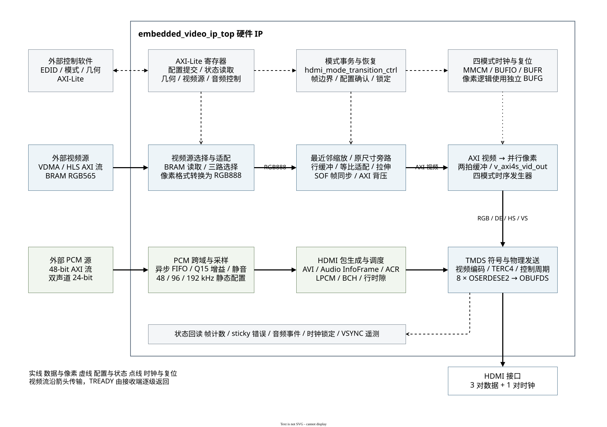
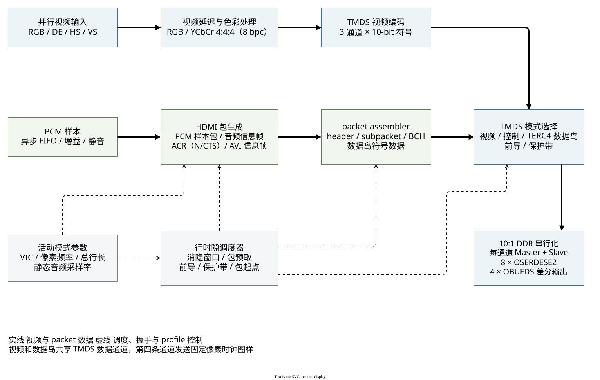

# EmbeddedVideoIP

EmbeddedVideoIP 是面向 AMD 7-series FPGA 的 HDMI 视频输出 IP 与 Zynq-7000 PS C 库。它提供视频源适配、最近邻缩放、四模式时序、PCM 音频封包和 TMDS 发送。当前源码与消费包版本为 `0.3.0-dev.6`，Vivado IP 的 `coreRevision` 为 `7`。

## 架构总览



图 1 视频与音频输入经过各自的处理路径，在 HDMI 发送端组合。AXI-Lite 统一控制几何、模式和音频。时钟与复位设计见[架构说明](docs/architecture.md)。



图 2 视频编码与音频封包在行时隙调度下合成为 TMDS 符号，再由四通道串行器输出。完整时钟路径见[时钟与复位图](docs/figures/clock-domains.svg)。

## 功能与接口

| 项目 | 当前配置 |
|---|---|
| 输出模式 | 640×480p60、1280×720p60、1920×1080p30、1920×1080p60，对应 VIC 1、4、34、16 |
| 视频输入 | AXI4-Stream Video，RGB565、RGB888 或 XRGB8888 适配，支持旁路与最近邻缩放 |
| 音频输入 | 48-bit AXI4-Stream，双声道 24-bit LPCM，静态配置 48/96/192 kHz |
| 控制接口 | AXI-Lite，几何与模式原子提交，DVI/HDMI framing，音频静音和增益 |
| 输出接口 | 三路 TMDS 数据差分对与一路时钟差分对 |
| 软件库 | 平台中立 C API 与 Zynq-7000 适配 |

1080p60 使用 148.5 MHz 像素时钟和 742.5 MHz 串行时钟，在 XC7Z020-1 上按超频实验配置维护。实现报告单列 OSERDESE2 pulse-width 例外。GBA 消费工程的最终 setup/hold、DRC 和实板结果见[验证记录](docs/validation-2026-11-24.md)。

## 集成到工程

1. 从 [GitHub Releases](https://github.com/ArthurPan2026/EmbeddedVideoIP/releases) 选择目标版本与 Vivado 版本匹配的硬件 IP ZIP，使用 `SHA256SUMS` 核验下载文件。
2. 在 Vivado 的 IP Repository 中加入包内 `ip_repo/`，实例化 `panfpga.org:video:embedded_video_ip:1.0`。
3. 按[快速开始](docs/ip-package-quickstart.md) 连接系统时钟、复位、AXI-Lite、视频、PCM 和 TMDS。
4. Zynq 应用使用同版本的 PS ZIP，配置 `Video/Lib/Inc` 和平台适配目录。

当前 dev.6 的生产包及 GBA 导入身份记录在[交付验证记录](docs/validation-2026-11-24.md)。GitHub 已发布版本以 Releases 页面为准。

## 源码开发与发布产物

使用 Vivado 2025.2.1 和 FPGAFlow 0.3.0。

```sh
git clone https://github.com/ArthurPan2026/EmbeddedVideoIP.git
cd EmbeddedVideoIP
fpga-flow --project fpga-project.toml plan
fpga-flow --project fpga-project.toml release
```

canonical RTL 位于 `ip/video_pipeline_1_0/`。打包阶段生成 IP 并比较注册源码，release 阶段生成硬件 ZIP、PS ZIP 与 `SHA256SUMS`。消费工程通过 FPGAFlow workspace 校验并导入同一生产产物。维护说明见[构建和使用](docs/build-and-use.md)。

## 文档与验证

- [接口与四模式参数](docs/composite-ip-api.md)、[寄存器表](docs/register-map.md)。
- [HDMI 1.4b 实现与测试映射](docs/hdmi-1.4b-conformance.md)。
- [验证方法](docs/validation.md)、[2026-11-24 源码与产物记录](docs/validation-2026-11-24.md)。

RTL/XSim 结果按测试台记录。消费工程实板结果按器件、时钟配置、图像采集、音频采集和人工观察分别归档。

## 许可

RTL 与硬件接口使用 CERN-OHL-W-2.0，PS C 库使用 Apache-2.0，文档使用 CC-BY-4.0。完整归属见[许可范围](LICENSES/README.md)。
