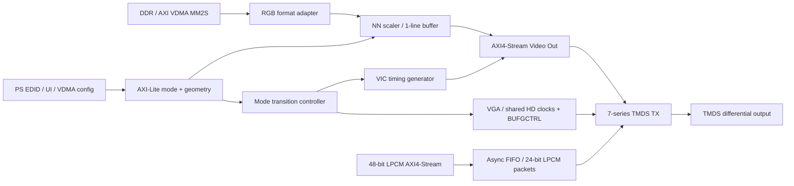

# EmbeddedVideoIP 架构与接口契约

## 模块关系

EmbeddedVideoIP 以一个 Vivado IP Integrator composite IP 交付。PL 负责视频缩放、输出时序、HDMI packet 和 TMDS。消费端 PS 读取 EDID，计算输入几何并提交输出模式。

PS/CIPS、DDR、VDMA MM2S、HPD 和 DDC 由消费工程提供。EDID 解析与 sink 能力选择属于消费端软件。

## 视频时序和模式切换

PL 提供 VIC 1、VIC 4 和 VIC 34：

| VIC | 时序 | 活动区 | 标称像素时钟 | 时钟 profile 实际像素时钟 |
|---:|---|---:|---:|---:|
| 1 | 640×480p60 | 640×480 | 25.175 MHz | 25.178571 MHz |
| 4 | 720p60 | 1280×720 | 74.250 MHz | 74.218750 MHz |
| 34 | 1080p30 | 1920×1080 | 74.250 MHz | 74.218750 MHz |

VIC 4 和 VIC 34 使用同一 HD clock profile。时序发生器按 VIC 选择 H/V totals、porches、同步宽度和极性。clock mux 使用 7-series BUFGCTRL 切换 VGA 与 HD 时钟。

切换控制器等当前帧 VSYNC 到达，再切换时钟。它保持像素域复位和 DVI-safe framing，直到时钟锁定、scaler 几何提交完成。复位释放后，控制器等新时序产生 VSYNC，再宣布模式生效并允许 HDMI 音频。

HD profile 实际像素时钟为 74.218750 MHz，较 74.25 MHz 标称值低约 421 ppm。ACR 使用实际时钟计算。显示器兼容性以目标板实测为准。

## 视频输入与缩放

VDMA 使用 XRGB8888，每拍一个像素。AXI4-Stream Video 以 TUSER[0] 标记帧首，以 TLAST 标记行尾。内部格式适配把 RGB565、RGB888 和 XRGB8888 转成 RGB888。

GBA 消费端默认使用 LVGL 原生 1280×720 输入。三帧 XRGB8888 VDMA 缓冲区各占 4 MiB。PS linker 将 0x18000000～0x18C00000 保留给这些缓冲区。设置 CMake 选项 PS_APP_NATIVE_720P_INPUT=OFF 可切换到 640×480 输入。

scaler 支持 11-bit source index、origin、step 和 DDA remainder。最高输入为 1280×720，最大输出为 1920×1080。BRAM 行缓冲保存缩放源行；一致的输入输出几何走 1:1 旁路。fit 模式根据源宽高比计算活动区和 letterbox/pillarbox offset。

## HDMI 色彩

默认输出为 RGB 4:4:4、8 bpc。静态参数可选择 YCbCr 4:4:4、8 bpc，以及 BT.601/BT.709 和 YCC range。AVI InfoFrame 随 VIC、色彩格式、色度和 range 更新。

当前像素输入接口为 RGB888。Deep Color 10 bpc 需要 30-bit pixel-group packing 和 1.25 倍 TMDS clock profile，当前不在实现范围内。

## 音频

消费端通过 100 MHz AXI4-Stream 提交 48-bit PCM：

- TDATA[23:0]：有符号 24-bit 左声道。
- TDATA[47:24]：有符号 24-bit 右声道。

GBA 16-bit PCM 由消费端 sign-extend 到 24-bit。I²S codec path 保持原样。TX 组装 LPCM sample packet、Audio InfoFrame 和 ACR packet。ACR N 由采样率 profile 选择，CTS 使用当前实际 pixel clock 与 H_TOTAL 计算。

## CDC 和复位

模式请求、active mode、profile lock、VSYNC 和音频控制按其时钟域同步。音频 gain 通过握手跨到像素域，跨域期间保持总线稳定。PCM 异步 FIFO 使用同步后的 Gray 指针。

时钟切换时，mode controller 将 pixel_reset_hold 送到视频输出 wrapper。wrapper 将其并入 proc_sys_reset 的复位输入，等所选 Clock Wizard lock 后同步释放像素域复位。
