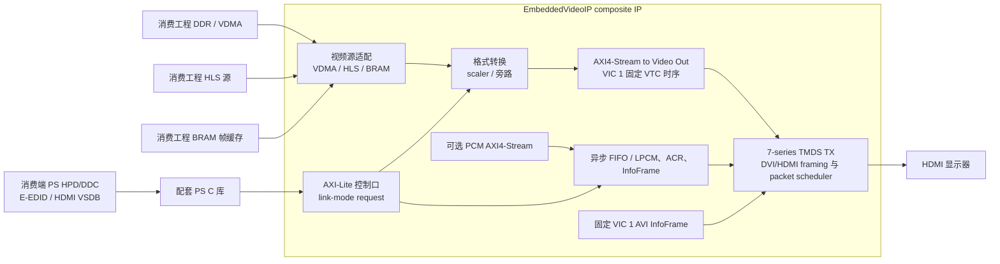

# EmbeddedVideoIP 架构与接口契约

## 产品层级

EmbeddedVideoIP 对消费者呈现为一个 Vivado IP Integrator composite IP；视频处理、HDMI 输出时序、7-series 发送适配和可选 HDMI 音频在内部拆成独立子模块。PS C 库与 PL composite IP 成对发布，但 PS/CIPS 仍由消费工程提供。

`video_pipeline` 是内部处理核，canonical 源码只维护在 `ip/video_pipeline_1_0/hdl/`。`ip_repo/` 是打包脚本的生成结果。消费者应添加顶层 `embedded_video_ip` VLNV，不需要分别实例化 scaler、VTC、`v_axi4s_vid_out` 或 HDMI TX。

## 视频接口契约

AXI4-Stream Video 每个握手 beat 对应一个像素。`TUSER[0]` 标记帧首，`TLAST` 标记行尾；在 `TVALID=1 && TREADY=0` 时，数据和旁带必须保持稳定。跨时钟源由消费端按时钟关系连接 Clock Converter。

输入包括：

- BRAM：同步 32-bit 读口，每字两个 RGB565 像素，低半字像素先出；调用方须在整帧读取期间保持 bank 稳定。
- HLS：AXI4-Stream Video。
- VDMA：AXI VDMA MM2S AXI4-Stream 视频输入；帧地址、HSIZE、VSIZE 和 STRIDE 由配套 PS adapter 配置。

内部颜色表示为 RGB888。AXI4-Stream Video 的 RBG 分量顺序、XRGB/BGRX 32-bit 容器和 BRAM RGB565 的转换在输入适配中完成。输出为 640×480p60 profile。最近邻 scaler 支持旁路、等比例留边和拉伸；越界几何或坏帧会置错误状态，坏帧丢弃到下一 SOF 后恢复。

### 视频静态裁剪

同一 IP 可使用参数固定视频源/格式，去掉运行时源选择逻辑；`ENABLE_SCALER=0` 走帧边界监测的直通通路；行缓冲可选 LUTRAM 或同步 BRAM。消费工程用 profile 选择这些特性，不需维护多个核心分支。

`ENABLE_HDMI_AUDIO=0` 时，综合会去掉 PCM FIFO、音频 packetizer 和通用包存储，保留固定 AVI Data Island serializer。`ENABLE_HDMI_AUDIO=1` 时，使用通用 packet store 处理 LPCM、ACR 和 Audio InfoFrame。

## 音频接口契约

可选音频接口是 100 MHz AXI4-Stream PCM 输入。每个有效 beat 携带一对 signed 16-bit 样本：左声道位于 `TDATA[15:0]`，右声道位于 `TDATA[31:16]`。V1 的 `AUDIO_SAMPLE_RATE_HZ` 默认值为 48000；消费项目源 adapter 负责按该采样率产生 `TVALID`。

EmbeddedVideoIP 内部为 HDMI 音频路径提供样本 FIFO、HDMI 子帧/音频包格式化、ACR 参数和 HDMI 发送调度。V1 固定为 2 声道 16-bit/48 kHz LPCM，并实现 Audio InfoFrame 与数据岛子集，HDMI 字段按 1.4b 和 CEA-861-D 核对；音频数据路径参考 AMD PG235 与 XAPP460。2026-11-16 在 GBA 消费工程上完成信号路径预验证，采集卡收到 PCM；尚未确认显示器扬声器听感，也未完成正式 HDMI 音频验收或认证，详见[预验证记录](validation-2026-11-16-hdmi-audio.md)。控制寄存器可使能/静音 HDMI 音频并设定 Q15 增益。EmbeddedVideoIP 不包含 I²S codec 发送器或特定 codec 控制；这类额外音频设备由消费工程管理。

## HDMI 与板级边界

V1 的 VTC profile 固定为 640×480p60。Zybo Z7-20 使用 50 MHz 参考时钟；当前 Vivado 时钟配置实际输出约 25.178571 MHz 像素时钟和 125.892857 MHz TMDS 串行时钟。时钟输入频率由 Zybo profile 固定，VTC 使用静态 profile，不占用额外 PS AXI-Lite 地址段。EmbeddedVideoIP 顶层只暴露 TMDS 信号。HPD/DDC 由消费系统的 PS GPIO/IIC 和板级约束负责。

当前 HDMI 发送适配器面向 Zybo Z7-20/XC7Z020。HDMI 顶层只暴露 TMDS 差分信号。HPD 与 DDC 不属于 EmbeddedVideoIP，由消费工程通过 GPIO、IIC 和板级约束处理。更换器件系列时必须为对应 PHY、时钟、I/O 约束与软件提供器件/板级 profile，并通过 OOC、完整实现、时序和实板验证后才能加入支持矩阵。RTL 不含器件原语不代表该系列已经通过验证。

## HDMI 1.4b link mode 与 packet contract

PL 内部由 7-series TX 负责 HDMI/DVI framing、行槽位、AVI/音频 packet 调度和 BCH 组包。DVI-safe 是复位默认状态；AXI-Lite bit 13 只表达 PS 的模式请求，TX 在像素时钟域同步后等待当前包结束和HSync 边沿消隐期切换。AVI 和 Audio InfoFrame 的发送标志由像素域 VSYNC 上升沿重置，避免维护重复的行计数器。GBA PS 读取并校验 E-EDID/CEA 扩展，在识别 HDMI VSDB 后才发出 HDMI 请求。协议字段及 CTS 对应项见 [HDMI 1.4b 合规映射](hdmi-1.4b-conformance.md)。

## PS 控制接口

单一 AXI4-Lite 接口包含视频处理控制和 HDMI 音频控制。配套 PS API 计算 fit/stretch 的有效区域和 DDA 比例，再提交视频配置；音频 API 写 HDMI 使能、静音和增益并读取 FIFO 欠载状态。完整字段定义见[寄存器表](register-map.md)，顶层端口见[组合式 IP 接口](composite-ip-api.md)。
