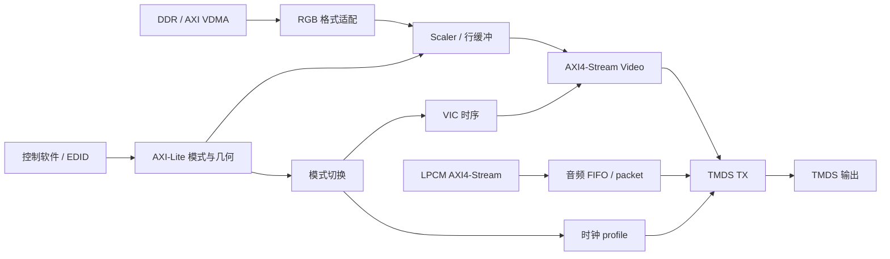

# EmbeddedVideoIP 架构与接口契约

EmbeddedVideoIP 以一个 Vivado IP Integrator composite IP 交付。PL 负责视频缩放、输出时序、HDMI packet 和 TMDS。外部控制软件读取 sink 能力，计算输入几何并提交输出模式。

## 输入与缩放

VDMA 使用 XRGB8888，每拍一个像素。AXI4-Stream Video 以 `TUSER[0]` 标记帧首，以 `TLAST` 标记行尾。格式适配支持 RGB565、RGB888 和 XRGB8888。scaler 支持旁路、最近邻缩放、fit 和 stretch，最大输入为 1280×720，最大输出为 1920×1080。

## 时序与模式切换

PL 提供 VIC 1、VIC 4 和 VIC 34。VIC 4 与 VIC 34 共用 HD clock profile。控制器在帧边界切换时钟，保持像素域复位和 DVI-safe framing，直到时钟锁定、几何提交完成并出现新 VSYNC。

## 音频

外部系统通过 48-bit AXI4-Stream 提交双声道 24-bit LPCM。`TDATA[23:0]` 为左声道，`TDATA[47:24]` 为右声道。源端在背压期间保持 `TDATA` 和 `TVALID` 稳定。TX 组装 LPCM sample packet、Audio InfoFrame 和 ACR packet。

## CDC 与复位

模式请求、active mode、profile lock、VSYNC 和音频控制按时钟域同步。PCM 异步 FIFO 使用同步后的 Gray 指针。时钟切换期间，pixel reset hold 等待所选 Clock Wizard lock 后同步释放。
