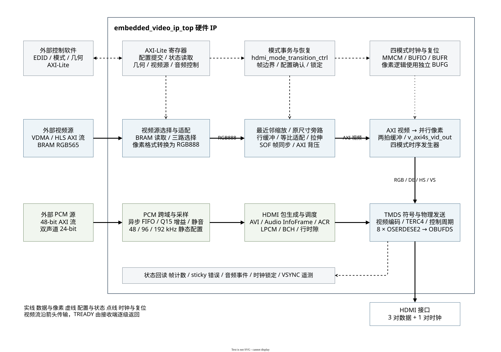
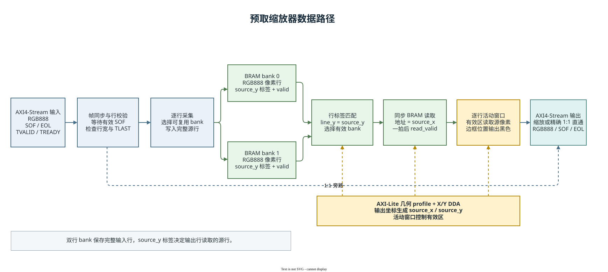
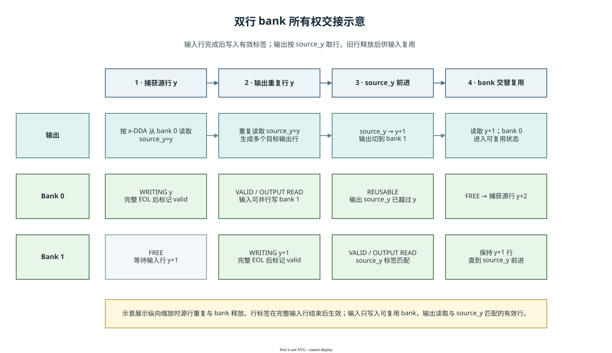
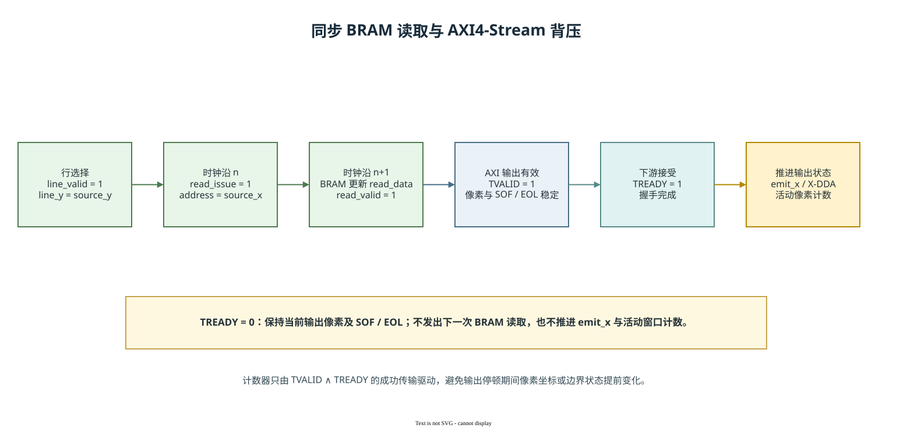
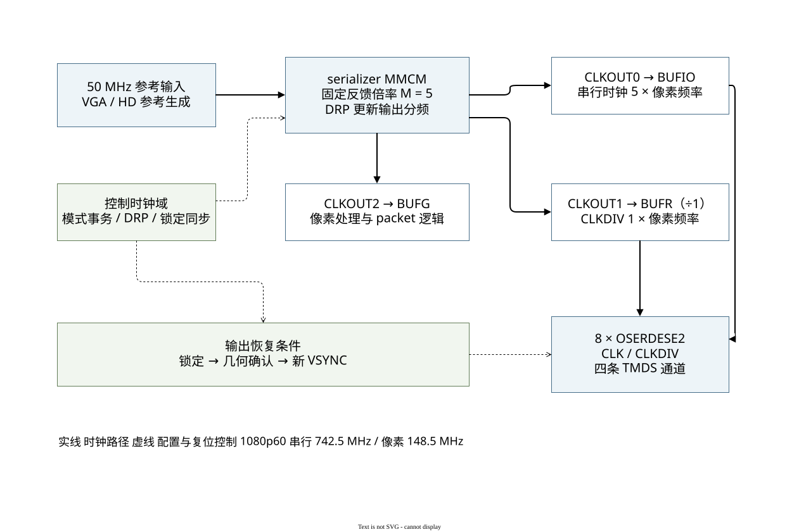
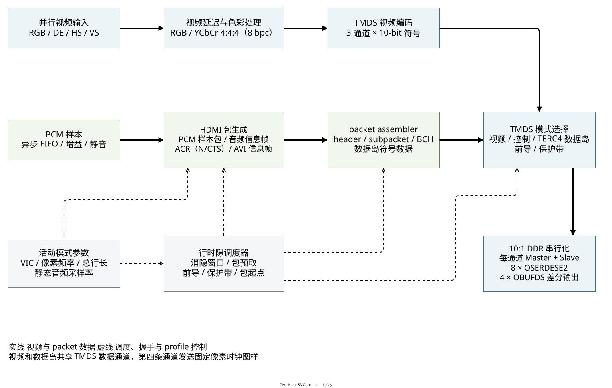

# EmbeddedVideoIP 架构

## 音视频路径

图 1 外部接口、IP 内部视频和音频路径，以及模式控制、时钟和状态回读。视频实线从左向右流动，在输出桥转换成并行像素，再与音频 packet 汇入发送端。

视频路径接收 AXI4-Stream 视频，输入适配器将 RGB565、RGB888 或 XRGB8888 统一转换为内部 RGB888。缩放输入最大 1280×720，输出最大 1920×1080。精确 1:1 profile 走直通路径，其他几何使用最近邻 DDA、fit 或 stretch。`TUSER[0]` 标记帧首，`TLAST` 标记行尾。重置或错误恢复时，输入等待有效 SOF 重新同步。

外部软件读取 EDID，并通过 AXI-Lite 提交输出模式和几何。VIC/profile 选择固定的像素时钟、总行长、采样门限和 ACR 参数，控制逐像素调度的组合路径长度。音频输入通过异步 FIFO 跨域，按静态 48/96/192 kHz 配置组装 LPCM、Audio InfoFrame 和 ACR 音频包。

| 图中模块 | 源码与时钟域 | 关键接口 |
|---|---|---|
| 寄存器与模式事务 | `axi_lite_video_regs`、`hdmi_mode_transition_ctrl`，aclk | AXI-Lite、mode commit、config ready、锁定与 VSYNC 同步 |
| 视频源适配与缩放 | `video_pipeline_v1_0`、`axis_video_nn_scaler_prefetch`，aclk | AXI 视频 TVALID/TREADY、SOF、EOL、几何提交 |
| 视频输出桥 | `embedded_video_ip_video_out_wrapper`，aclk → pixel_clk | 两拍入口缓冲、`v_axi4s_vid_out`、RGB/DE/HS/VS |
| 音频包源 | `hdmi_pcm_packet_source`，audio_pcm_clk → pixel_clk | 48-bit PCM、异步 FIFO、包 valid/ready、取消与完成 |
| 行时隙与符号选择 | `hdmi_line_slot_scheduler`、`hdmi_tmds_mode_mux`，pixel_clk | line_prepare、packet_start、symbol_mode、三路 10-bit 符号 |
| PHY | `hdmi_four_mode_clocks`、OSERDESE2、OBUFDS | pixel_clk、serdes_pixel_clk、serial_clk、四对 TMDS |

## 双行 BRAM 预取缩放器

### 数据路径

图 2 输入行完成后写入空闲 bank。`source_y` 标签选择输出行对应的 bank，`source_x` 驱动同步 BRAM 地址。坐标控制与行数据路径分离，AXI-Lite 几何事务配置源尺寸、目标尺寸、裁切起点、fit 和 stretch。

`video_pipeline_v1_0` 在 `LINE_BUFFER_IMPLEMENTATION=1` 时实例化 `axis_video_nn_scaler_prefetch`。两个 24-bit BRAM bank 各保存一条完整输入行，只有完整且行尾有效时才发布对应的 `line_y` 标签。另一实现保留单行 scaler，并可选 LUTRAM 或同步 BRAM。

### 行缓存交接

图 3 垂直 DDA 可以让多个输出行映射到同一源行。当前 bank 保留该行，输入端把后续行写入空闲 bank；当 `source_y` 越过旧标签后，旧 bank 标记为可复用。每个 bank 的 `line_y` 与 `line_valid` 共同决定输出选行。

### 同步读取与背压

图 4 同步 BRAM 在地址请求后的一个时钟沿提供 `read_data` 并置位 `read_valid`。输出 `TREADY=0` 时保持当前像素与 `SOF/EOL`，不发起下一次读取，也不推进 `emit_x` 与活动窗口计数。输入采集使用另一个可复用 bank 并行工作。

## 时钟与复位

图 5 参考时钟与 serializer MMCM 生成像素及串行时钟。实线表示时钟路径，虚线表示复位和状态控制。

`hdmi_four_mode_clocks` 选择 VGA/HD 参考，serializer `MMCME2_ADV` 使用固定反馈倍率 5，运行时通过 DRP 修改输出分频。`CLKOUT0` 经 BUFIO 驱动 OSERDESE2 `CLK`，`CLKOUT1` 经 `BUFR_DIVIDE=1` 驱动 `CLKDIV`。独立 BUFG 输出供像素逻辑使用，监测时钟单独缓冲。四条 TMDS 通道共使用 8 个 OSERDESE2。

模式控制器在帧边界进入切换，保持像素域与串行器复位，等待参考锁定、DRP 完成、配置确认和新 VSYNC 后恢复输出。scaler 在 mode reset hold 期间清空帧状态。PCM 异步 FIFO 同步 Gray 指针，控制与遥测按目标时钟域同步。

## 包调度与事务

图 6 并行像素与 PCM 的封包、编码、时隙调度和 TMDS 输出。实线表示数据，虚线表示 profile 与调度控制。

行时隙调度器提前准备 packet 起点和可用窗口，发送器在视频消隐区调度 AVI、Audio InfoFrame、ACR 和 PCM sample packet。静态 profile 的时序与音频常量统一由 VIC 选择。

CTRL 的模式位与提交位、几何提交构成一次配置事务。控制器依次处理请求、帧结束、时钟、几何和输出恢复。错误与失败阶段保存在寄存器，供消费软件决定回滚模式或 DVI 恢复。

## 源码与消费包

`ip/video_pipeline_1_0/` 保存 canonical RTL/XDC。`ip_repo/` 保存对应的可集成快照。打包工具生成 `component.xml` 与 `PACKAGE_METADATA.json`，比较注册源码和 canonical 文件。当前发布身份为 `0.3.0-dev.15 / coreRevision 16`。

release 产物包含硬件 IP、PS C 库、版本、许可和文件哈希。消费工程保存 ZIP SHA-256 与导入目录树哈希。dev.15 的 XSim、主机测试、发布包哈希与导入身份见[交付记录](validation-2026-11-25.md)。
